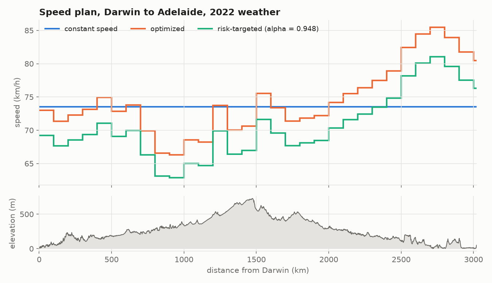
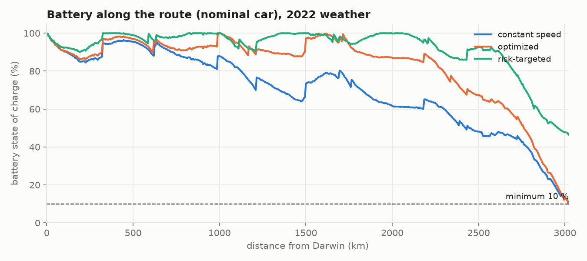
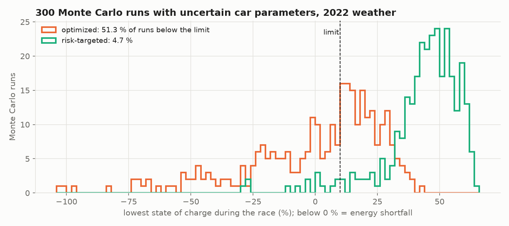

# solar-race-strategy-demo

How fast should a solar car drive on each part of the 3,021 km road from Darwin to Adelaide? This repository answers that question for an example car. It simulates the race with 10 years of real weather, optimizes the speed for every 100 km, and checks how often the plan would run the battery flat when the car's real parameters differ from the numbers on paper.

This is a public, simplified version of the race strategy software I am building for the ITU Solar Car Team for the 2027 Bridgestone World Solar Challenge. The team's code and car data are private. This repository uses illustrative car parameters and public data only, so its numbers are not the team's numbers.

## Results

With 2022 weather (full table in [docs/results.md](docs/results.md)):

| plan | race time (without nights) | lowest battery, nominal car | Monte Carlo runs below the 10 % limit |
|---|---|---|---|
| fastest constant speed, 73.5 km/h | 45 h 35 min | 10.4 % | 48.7 % |
| optimized speed per 100 km | 45 h 18 min | 10.0 % | 51.3 % |
| optimized, all speeds x 0.948 | 47 h 31 min | 46.6 % | 4.7 % |



The optimized plan is slowest between km 700 and 1,000 (about 66 km/h) and fastest on the last day, from km 2,500 to the finish, where it uses up the rest of the battery.



Both the constant-speed plan and the optimized plan are planned to finish exactly on the battery limit. This is the fastest a car with these exact parameters can go, and it leaves no margin.



The Monte Carlo analysis shows the cost of having no margin. Each of the 300 runs draws its own drag, rolling resistance, array output, battery capacity, drivetrain efficiency and auxiliary load. Driven as planned, the optimized plan falls below 10 % in about half of them. Slowing every block by the same factor, found by bisection, brings that down to 4.7 % and costs 2 h 13 min.

Back-test over 2016-2025 race weeks:

| | min | max |
|---|---|---|
| time gained by optimizing, vs. constant speed | 3 min | 27 min |
| runs below the limit, optimized plan | 49.7 % | 51.3 % |
| speed factor for at most 5 % risk | 0.913 | 0.948 |
| time cost of that safety margin | +131 min | +215 min |

The optimized plan beat the constant-speed plan in all 10 years.

## How it works

1. **Route** ([route.py](src/solarstrat/route.py)): 3,021 km of road geometry and elevation, split into 5 km segments with slope and heading.
2. **Weather** ([weather.py](src/solarstrat/weather.py)): hourly ERA5 reanalysis (solar irradiance, temperature, wind) at 14 points along the route, downloaded from the Open-Meteo REST API.
3. **Simulation** ([simulate.py](src/solarstrat/simulate.py)): for each segment the power needed for rolling resistance, slope and air drag (including the wind component along the road) is set against the solar array output. The race rules are built in: driving only 08:00-17:00, array charging in camp until 19:00 and from 06:30, nine 30 minute control stops, 60-110 km/h. One run takes about 10 ms.
4. **Optimization** ([optimize.py](src/solarstrat/optimize.py)): SciPy SLSQP picks one speed per 100 km block to minimize driving time, with the constraint that the battery never drops below 10 %. It starts from the best constant speed, found by bisection.
5. **Risk** ([risk.py](src/solarstrat/risk.py)): every car parameter in the simulator can be a NumPy array, so 300 Monte Carlo "worlds" run in a single pass (about 0.05 s).

## Run it

```bash
python -m venv .venv
.venv/Scripts/activate          # Windows; on Linux/macOS: source .venv/bin/activate
pip install -e ".[dev]"

pytest                          # 30 tests, about 1 s
python scripts/run_demo.py      # figures + results table, about 3 min
python scripts/fetch_weather.py 2016 2025   # download the weather again (optional)
```

## Tests

The tests in [tests/](tests) check the physics against hand calculations (flat-road power, energy balance with no sun), the sun position in Darwin against a known value, the race rules (no driving outside 08:00-17:00, a control stop that reaches 17:00 is finished the next morning), and that the vectorized Monte Carlo gives the same answer as single runs.

## Simplifications

Compared with the team's model, this demo leaves out: a tilted array during charging stops, a battery voltage and resistance model, motor efficiency maps, road speed limits per section, traffic, and forecast uncertainty. The car parameters in [config.py](src/solarstrat/config.py) are typical values for a Challenger-class car, not measurements.

## Data

- Route geometry: (c) OpenStreetMap contributors, [ODbL](https://opendatacommons.org/licenses/odbl/), routed with OSRM.
- Elevation: Copernicus GLO-90 DEM via the Open-Meteo Elevation API.
- Weather: ERA5 reanalysis (Copernicus Climate Change Service) via the [Open-Meteo Historical Weather API](https://open-meteo.com/), CC BY 4.0.
- Control stop distances and driving hours: BWSC Route Notes and Event Regulations.

Built with help from an AI coding assistant. Code under the [MIT License](LICENSE).
